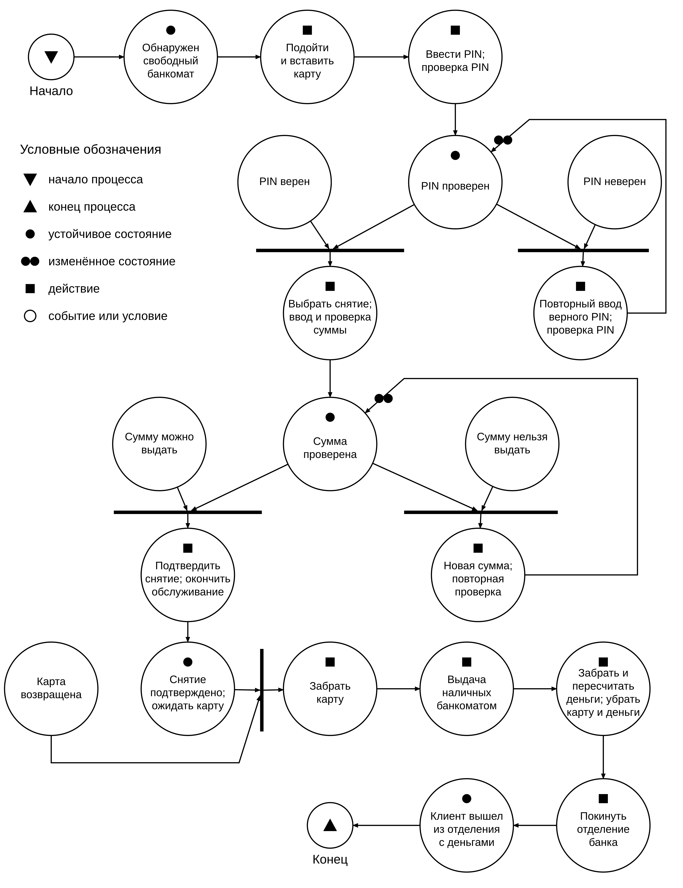
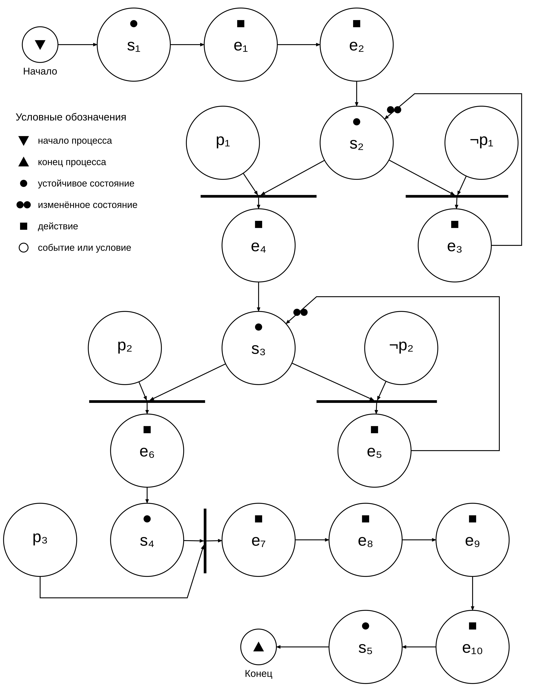

# Сети Петри простых ситуаций

Российский университет транспорта (МИИТ)

Институт железнодорожного транспорта

Кафедра «Интеллектуальное управление и информационная безопасность в высокоавтоматизированных транспортных системах»

Отчёт по практическому заданию 00

Дисциплина: Web-программирование

Вариант 7 — Снятие наличных денежных средств через банкомат

Выполнил: Тумасян Тигран Аршакович, группа ТКИ-541

Проверил: Сафронов Антон Игоревич

Москва, 2026

## 1. Цель работы

Описать процесс снятия наличных через банкомат и представить его полной и краткой сетями Петри, выделив состояния, действия и события.

## 2. Формулировка задачи

Вариант 7: «Снятие наличных денежных средств через банкомат в отделении банка». Границы процесса: от обнаружения свободного банкомата до ухода из отделения с полученными деньгами. Требуется описание ситуации, полная и краткая сети Петри в Draw.io и расшифровка краткой сети.

## 3. Детализированное текстовое описание ситуации

Обнаружив свободный банкомат, я подхожу к нему и вставляю карту в картоприёмник. Банкомат принимает карту и предлагает ввести PIN. Прикрывая клавиатуру рукой, я ввожу код и подтверждаю ввод. Банкомат проверяет PIN. Если код верен, открывается меню операций. Если при первом вводе я ошибся, читаю сообщение об ошибке и повторно ввожу правильный PIN. После проверки открывается меню.

Я выбираю снятие наличных и ввожу сумму. Банкомат проверяет остаток на счёте, лимит снятия и наличие подходящих купюр. Если выдача невозможна, я читаю сообщение, ввожу другую сумму и дожидаюсь повторной проверки. Повторяю выбор суммы, пока банкомат не разрешит выдачу.

Я подтверждаю снятие и завершаю обслуживание. Ожидаю возврата карты и забираю её из картоприёмника. После этого банкомат выдаёт наличные. Я забираю и пересчитываю деньги, убираю карту и деньги в кошелёк и ухожу из отделения банка.

Допущения: банкомат исправен и возвращает карту до выдачи наличных; карта действительна; повторный ввод PIN успешен; допустимую сумму удаётся подобрать. Отмена, блокировка карты и технические сбои не рассматриваются.

<!-- pagebreak -->

## 4. Сеть Петри — схема ситуации

### 4.1. Полная

Полная сеть на рисунке 1 показывает состояния, действия и условия описанного процесса. Условные обозначения приведены в легенде схемы.

<!-- pagebreak -->

### 4.2. Краткая

В краткой сети на рисунке 2 сохранены все узлы и связи полной сети. Текстовые подписи заменены обозначениями s, e и p; знак ¬ означает отрицание условия.

<!-- pagebreak -->

### 4.3. Описание краткой сети Петри

Состояния обозначены буквой s и чёрной точкой, действия — буквой e и чёрным квадратом. События и условия p изображены пустыми кругами с подписью. Чёрная планка объединяет состояние и условие, необходимые для продолжения. Две точки у возвратной дуги обозначают изменённое состояние: выполнена новая проверка PIN или суммы. Треугольники обозначают начало и конец процесса.

**Состояния**

- s1 — обнаружен свободный банкомат.
- s2 — PIN введён и проверен банкоматом.
- s3 — запрошенная сумма проверена банкоматом.
- s4 — снятие подтверждено, клиент ожидает возврата карты.
- s5 — клиент вышел из отделения с полученными деньгами.

**Действия**

- e1 — подойти к банкомату и вставить карту.
- e2 — ввести PIN и дождаться его проверки банкоматом.
- e3 — повторно ввести правильный PIN и дождаться проверки.
- e4 — выбрать снятие наличных, ввести сумму и дождаться проверки.
- e5 — изменить сумму и дождаться повторной проверки.
- e6 — подтвердить снятие и завершить обслуживание.
- e7 — забрать возвращённую карту.
- e8 — выдача наличных банкоматом после получения карты клиентом.
- e9 — забрать и пересчитать наличные, убрать карту и деньги.
- e10 — покинуть отделение банка.

<!-- pagebreak -->

**События и условия**

- p1 — введённый PIN верен.
- ¬p1 — введённый PIN неверен.
- p2 — запрошенную сумму можно выдать: достаточно средств, соблюдён лимит и имеются подходящие купюры.
- ¬p2 — запрошенную сумму выдать нельзя: хотя бы одно из перечисленных условий не выполнено.
- p3 — карта возвращена банкоматом и доступна для получения.

**Порядок прохождения сети**

От начала процесс проходит через s1, e1 и e2 к состоянию s2. При p1 выполняется e4 и достигается s3. При ¬p1 выполняется e3, после чего процесс возвращается к s2 с новым результатом проверки. По принятому допущению после e3 выполняется p1.

В состоянии s3 при p2 выполняется e6 и достигается s4. При ¬p2 выполняется e5, затем процесс возвращается к s3 с новым результатом проверки суммы. Проверка повторяется до выполнения p2.

В состоянии s4 клиент ожидает события p3. После возврата карты последовательно выполняются e7, e8, e9 и e10. Достигается s5, затем процесс завершается. Условия p1 и ¬p1, как и p2 и ¬p2, взаимоисключающие: для одного результата проверки выбирается только одна ветвь.

## 5. Вывод по работе

Процесс снятия наличных описан от обнаружения свободного банкомата до ухода из отделения с деньгами. Построены полная и краткая сети с одинаковыми узлами и связями. В них выделены состояния, действия, результаты проверок PIN и суммы, повторные попытки и ожидание возврата карты. Для всех обозначений краткой сети приведена расшифровка.
