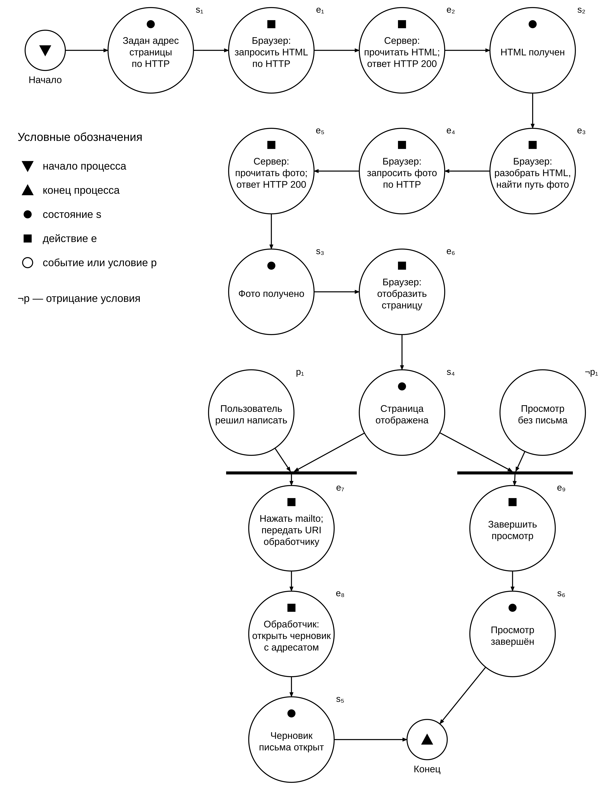
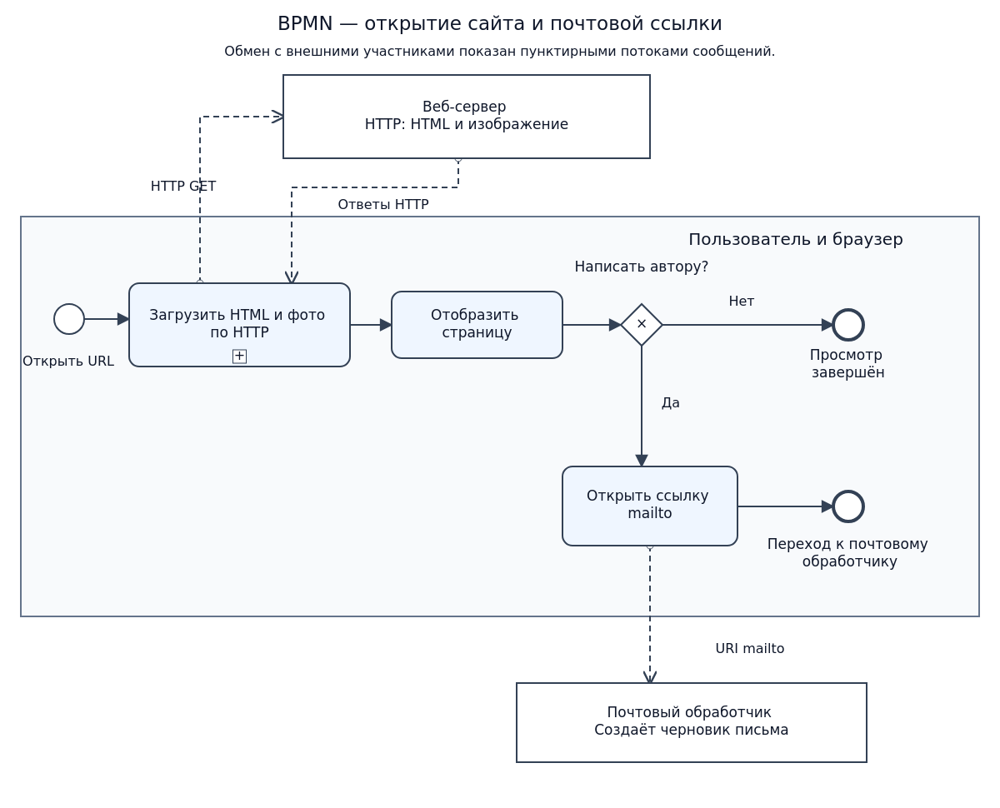
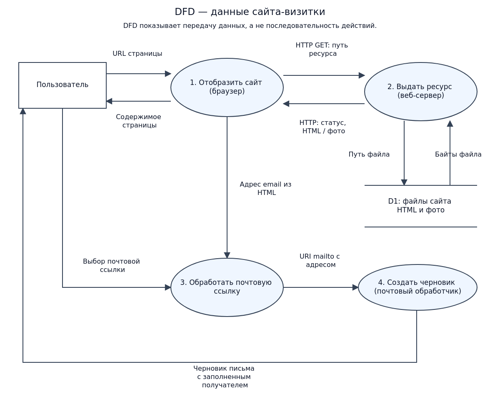
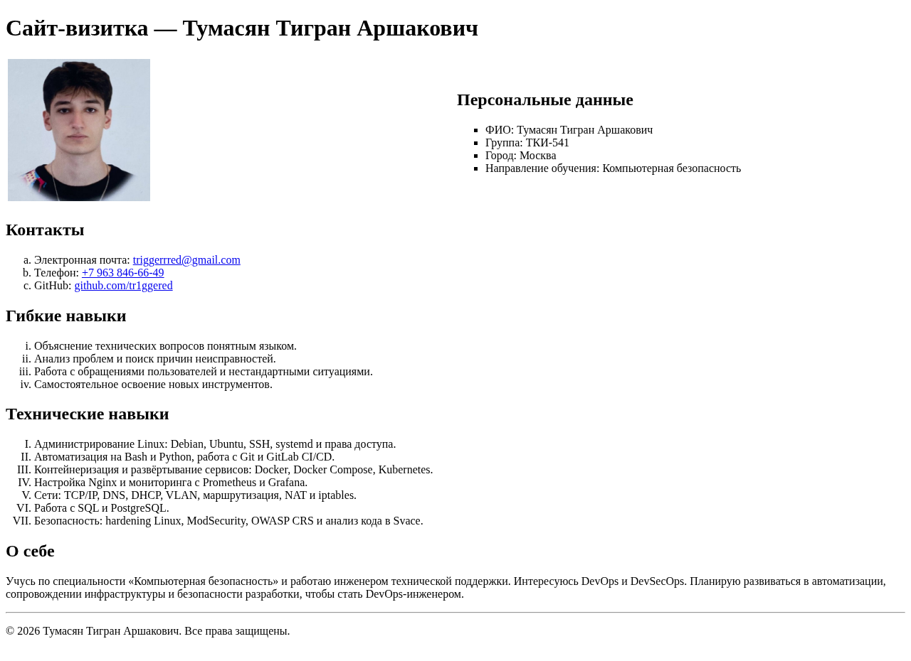

# Подготовка сайта визитки на основе фиксированной структуры

Российский университет транспорта (МИИТ)

Институт железнодорожного транспорта

Дисциплина: Web-программирование

Вариант 7

Выполнил: Тумасян Тигран Аршакович, группа ТКИ-541

Проверил: Сафронов Антон Игоревич

Москва, 2026

## 1. Цель работы

Создать сайт-визитку средствами HTML по макету варианта 7 и описать работу страницы по HTTP с использованием сети Петри, BPMN и DFD.

## 2. Формулировка задачи

Разработать файл index_tumasyan_t_a.html. Разместить заголовок первого уровня, фотографию слева и персональные данные справа; затем контакты, гибкие и технические навыки, дополнительное описание и сведения об авторских правах. Для персональных данных использовать квадратные маркеры, для контактов — строчные буквы, для гибких навыков — строчные римские цифры, для технических — заглавные римские цифры.

Использовать HTML без CSS и JavaScript. Добавить обязательную ссылку mailto. Подготовить три модели технологического процесса, листинг HTML и скриншот страницы. Комплект сдачи включает отчёт DOCX, HTML-файл и использованную фотографию.

## 3. Содержательная часть

### 3.1. Модель технологического процесса

Пользователь вводит HTTP-адрес страницы. Браузер отправляет GET-запрос, веб-сервер читает HTML-файл и возвращает ответ HTTP 200 с разметкой. Браузер разбирает HTML, находит относительный адрес фотографии и отправляет второй GET-запрос. Сервер читает изображение и возвращает его в ответе HTTP 200. Браузер отображает страницу с фотографией.

После просмотра пользователь может завершить работу либо нажать ссылку электронной почты. Во втором случае браузер передаёт URI mailto почтовому обработчику, который открывает черновик с заполненным адресом получателя. Отправка письма находится за границами процесса. Переходы по ссылкам телефона и GitHub в эти модели не включены.

Допущения: сервер запущен, файлы доступны, кэш не используется, запросы успешны, почтовый обработчик настроен. Загрузка изображена последовательно для наглядности; браузер может начать показ содержимого раньше полной загрузки фотографии.

<!-- pagebreak -->

**Сеть Петри**

Использованы обозначения учебного образца: состояния s, действия e, условия p, планки объединения состояния и условия, начало и конец процесса. Обе ветви завершения показаны явно.



<!-- pagebreak -->

**Описание сети Петри**

**Состояния**

- s1 — задан HTTP-адрес страницы.
- s2 — HTML получен браузером.
- s3 — фотография получена браузером.
- s4 — страница отображена.
- s5 — почтовый обработчик открыл черновик письма.
- s6 — пользователь завершил просмотр без перехода к письму.

**Действия**

- e1 — браузер отправляет HTTP GET для HTML-страницы.
- e2 — сервер читает HTML и возвращает HTTP 200 с разметкой.
- e3 — браузер разбирает HTML и определяет адрес фотографии.
- e4 — браузер отправляет HTTP GET для фотографии.
- e5 — сервер читает фотографию и возвращает HTTP 200 с изображением.
- e6 — браузер отображает страницу.
- e7 — пользователь нажимает mailto; браузер передаёт URI обработчику.
- e8 — почтовый обработчик открывает черновик с адресом получателя.
- e9 — пользователь завершает просмотр без письма.

**События и условия**

- p1 — пользователь решил написать автору.
- ¬p1 — пользователь завершает просмотр без письма.

После s4 выбирается одна из двух взаимоисключающих ветвей. При p1 выполняются e7 и e8, достигается s5. При ¬p1 выполняется e9, достигается s6. Обе ветви приводят к концу рассматриваемого процесса.

<!-- pagebreak -->

**Модель BPMN**

Основной пул представляет пользователя и браузер. Загрузка HTML и фотографии объединена в свёрнутый подпроцесс, обозначенный знаком «+». Внутри него последовательно выполняются запрос HTML, получение ответа, разбор разметки, запрос фотографии и получение изображения. После отображения страницы исключающий шлюз «Написать автору?» выбирает одну ветвь: завершить просмотр или открыть mailto.

Веб-сервер и почтовый обработчик показаны отдельными пулами без раскрытия внутреннего процесса. Сплошные потоки задают порядок действий внутри основного пула. Пунктирные потоки сообщений связывают участников: запросы и ответы HTTP, затем передача URI mailto. Конечное событие почтовой ветви основного пула означает передачу управления обработчику; открытие черновика выполняется этим внешним участником.



<!-- pagebreak -->

**Модель DFD**

Граница модели охватывает браузер, веб-сервер, файлы сайта и почтовый обработчик. Пользователь — внешняя сущность. Процессы 1–4 отображают сайт, выдают ресурс, обрабатывают почтовую ссылку и создают черновик. Хранилище D1 содержит HTML и фотографию.

Потоки данных подписаны по содержимому: URL, HTTP-запрос с путём ресурса, HTTP-ответ со статусом и содержимым, путь файла, байты файла, отображаемая страница, выбор почтовой ссылки, адрес электронной почты, URI mailto и черновик. Путь к файлу на входе D1 задаёт запрос чтения, а не изменение файла. DFD показывает передачу данных, а не порядок действий.



<!-- pagebreak -->

### 3.2. Разметка HTML

Страница содержит h1 и блоки div по макету. В верхнем блоке таблица размещает фотографию и персональные данные в двух колонках. Квадратная фотография отображается размером 200 × 200 пикселей без изменения пропорций. Списки используют type со значениями square, a, i и I. Контакты представлены ссылками mailto, tel и HTTPS.

Для воспроизведения учебного макета без CSS применены устаревшие атрибуты width и valign у таблицы и type у ul. Стили, сценарии и внешние библиотеки не используются. Ниже приведён полный исходный код страницы.

```html
<!DOCTYPE html>
<html lang="ru">
<head>
  <meta charset="UTF-8">
  <meta name="viewport" content="width=device-width, initial-scale=1.0">
  <title>Сайт-визитка — Тумасян Тигран Аршакович</title>
</head>
<body>
  <div>
    <h1>Сайт-визитка — Тумасян Тигран Аршакович</h1>
  </div>

  <div>
    <!-- Таблица размещает фото слева, а персональные данные справа без CSS. -->
    <table width="100%">
      <tr>
        <td width="50%" valign="middle">
          <div>
            
          </div>
        </td>
        <td width="50%" valign="middle">
          <div>
            <h2>Персональные данные</h2>
            <ul type="square">
              <li>ФИО: Тумасян Тигран Аршакович</li>
              <li>Группа: ТКИ-541</li>
              <li>Город: Москва</li>
              <li>Направление обучения: Компьютерная безопасность</li>
            </ul>
          </div>
        </td>
      </tr>
    </table>
  </div>

  <div>
    <h2>Контакты</h2>
    <ol type="a">
      <li>Электронная почта:
        <a href="mailto:triggerrred@gmail.com">triggerrred@gmail.com</a>
      </li>
      <li>Телефон: <a href="tel:+79638466649">+7 963 846-66-49</a></li>
      <li>GitHub: <a href="https://github.com/tr1ggered">github.com/tr1ggered</a></li>
    </ol>
  </div>

  <div>
    <h2>Гибкие навыки</h2>
    <ol type="i">
      <li>Объяснение технических вопросов понятным языком.</li>
      <li>Анализ проблем и поиск причин неисправностей.</li>
      <li>Работа с обращениями пользователей и нестандартными ситуациями.</li>
      <li>Самостоятельное освоение новых инструментов.</li>
    </ol>
  </div>

  <div>
    <h2>Технические навыки</h2>
    <ol type="I">
      <li>Администрирование Linux: Debian, Ubuntu, SSH, systemd и права доступа.</li>
      <li>Автоматизация на Bash и Python, работа с Git и GitLab CI/CD.</li>
      <li>Контейнеризация и развёртывание сервисов: Docker, Docker Compose, Kubernetes.</li>
      <li>Настройка Nginx и мониторинга с Prometheus и Grafana.</li>
      <li>Сети: TCP/IP, DNS, DHCP, VLAN, маршрутизация, NAT и iptables.</li>
      <li>Работа с SQL и PostgreSQL.</li>
      <li>Безопасность: hardening Linux, ModSecurity, OWASP CRS и анализ кода в Svace.</li>
    </ol>
  </div>

  <div>
    <h2>О себе</h2>
    <p>Учусь по специальности «Компьютерная безопасность» и работаю инженером технической поддержки.
      Интересуюсь DevOps и DevSecOps. Планирую развиваться в автоматизации,
      сопровождении инфраструктуры и безопасности разработки, чтобы стать DevOps-инженером.</p>
  </div>

  <div>
    <hr>
    <p>&copy; 2026 Тумасян Тигран Аршакович. Все права защищены.</p>
  </div>
</body>
</html>
```

<!-- pagebreak -->

### 3.3. Результат отображения в браузере

Страница проверена в Chrome через локальный HTTP-сервер. Из корня репозитория сервер запускается командой:

```bash
python3 -m http.server 8000 --bind 127.0.0.1 --directory task01
```

Адрес страницы: http://127.0.0.1:8000/index_tumasyan_t_a.html



HTML и фотография загружаются с ответом HTTP 200. Проверены блоки, четыре вида списков и адреса контактных ссылок. Почтовая ссылка содержит mailto:triggerrred@gmail.com; запуск обработчика зависит от настроек компьютера. Письмо при проверке не отправлялось.

## 4. Вывод

Создан HTML-сайт-визитка по варианту 7 с фотографией, контактами и навыками. Загрузка по HTTP и переход по почтовой ссылке представлены сетью Петри, BPMN и DFD. Проверено отображение страницы; в отчёт включены исходный код и скриншот.
